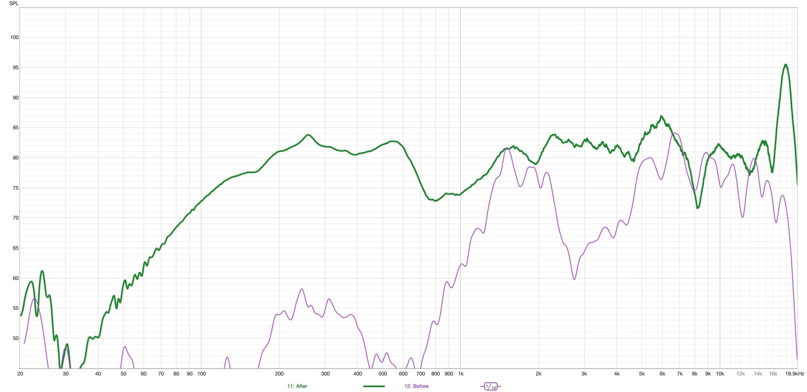
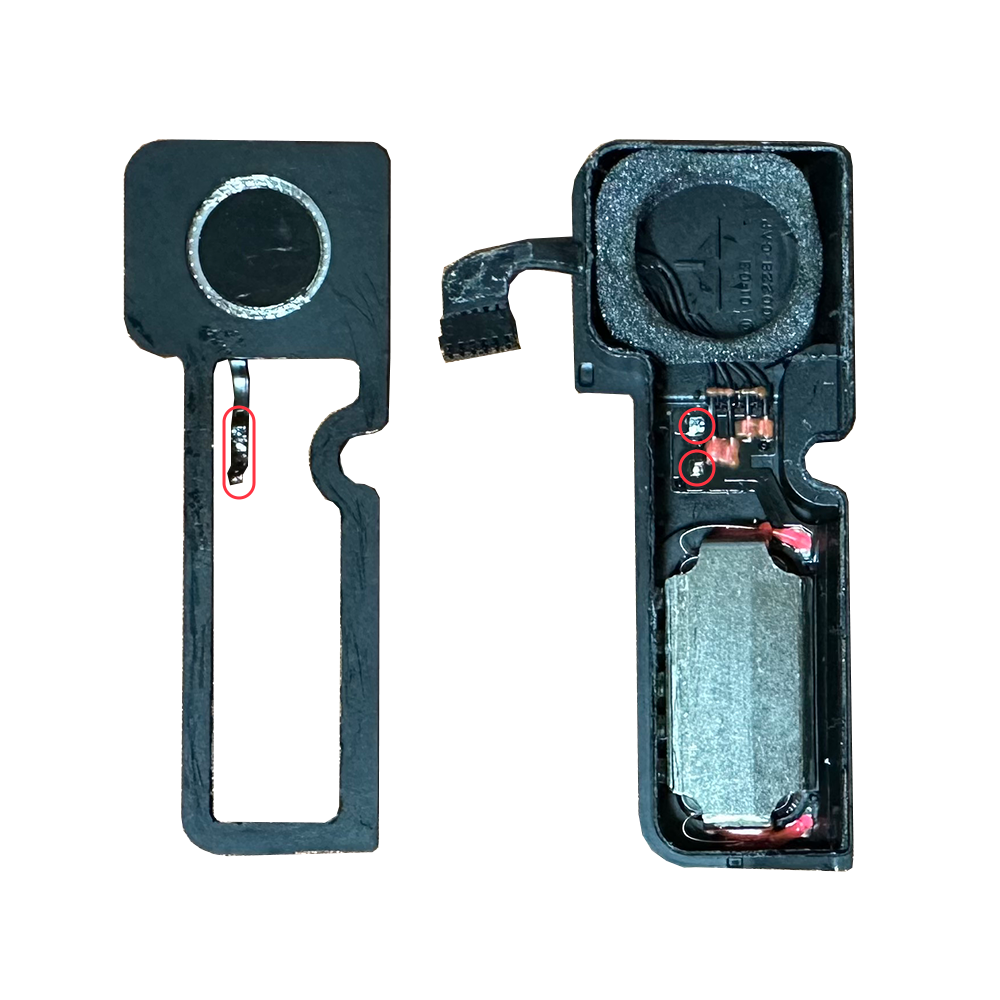
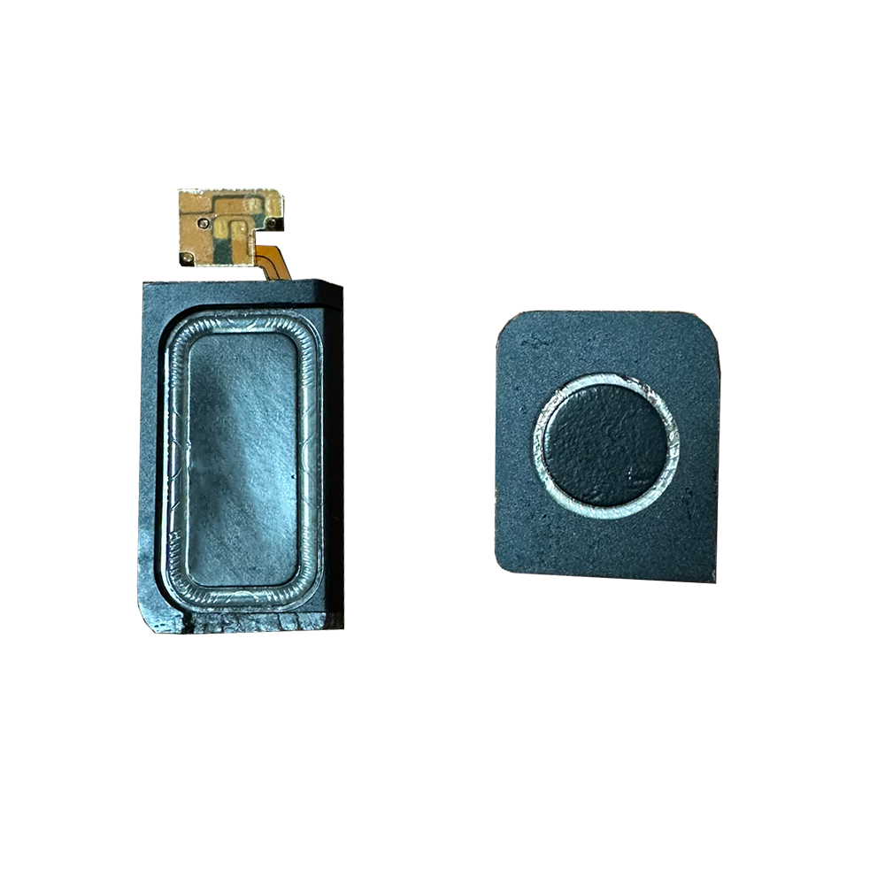
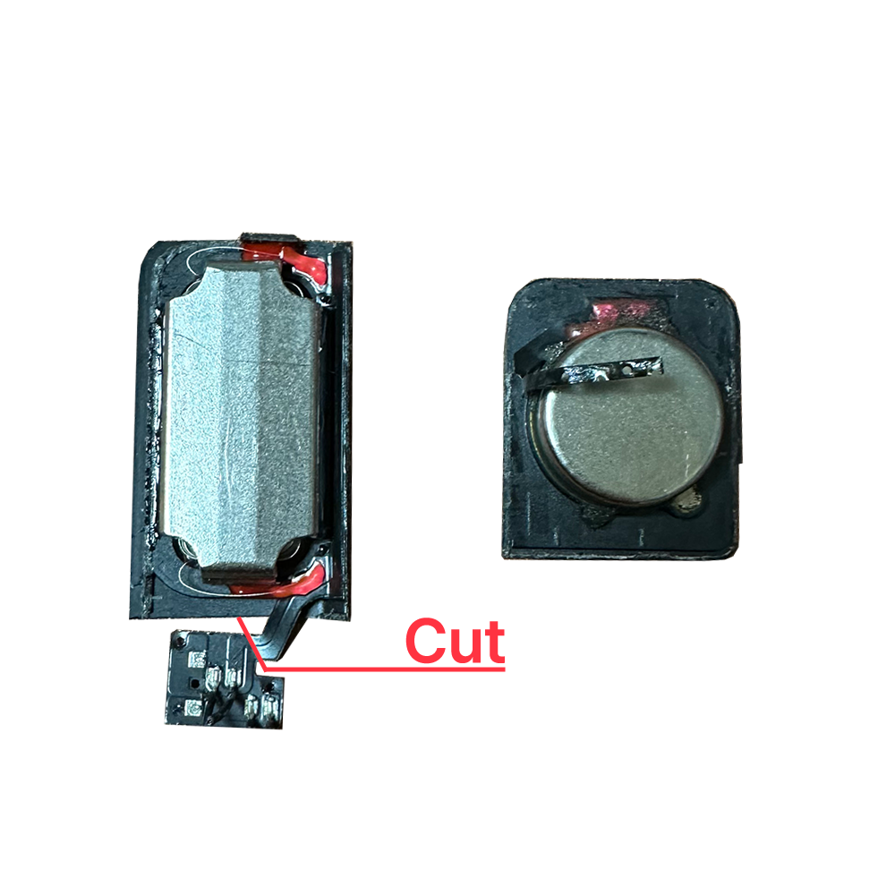
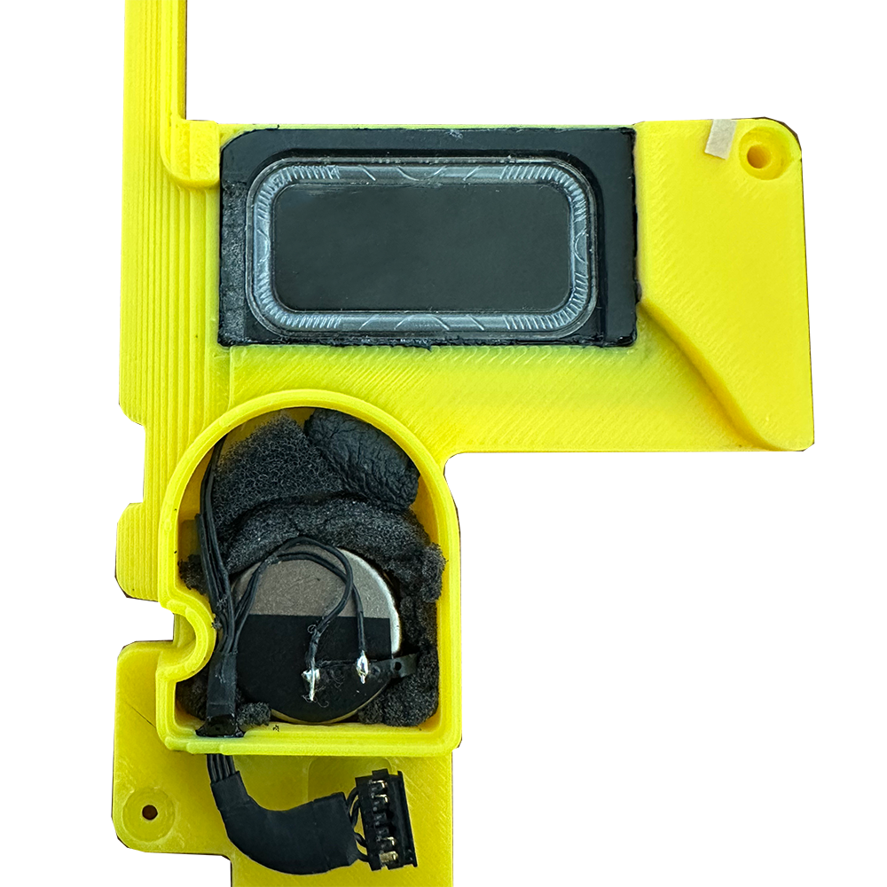
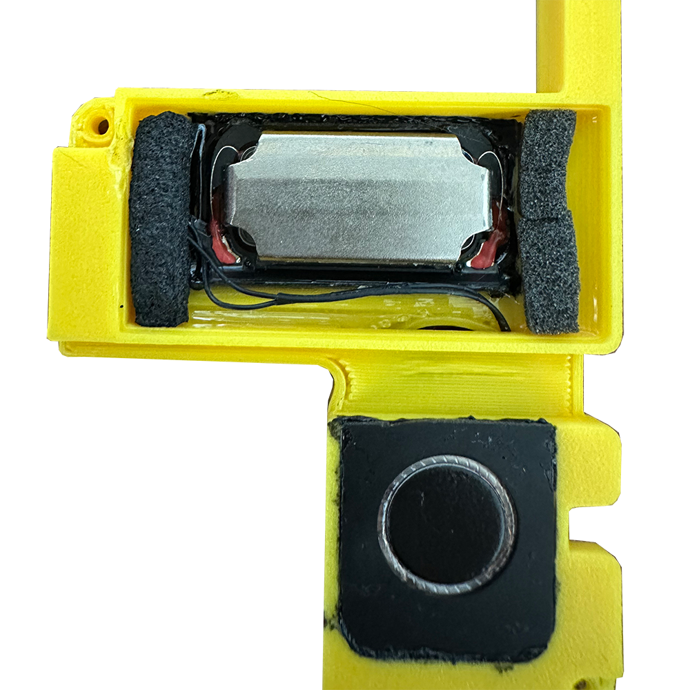
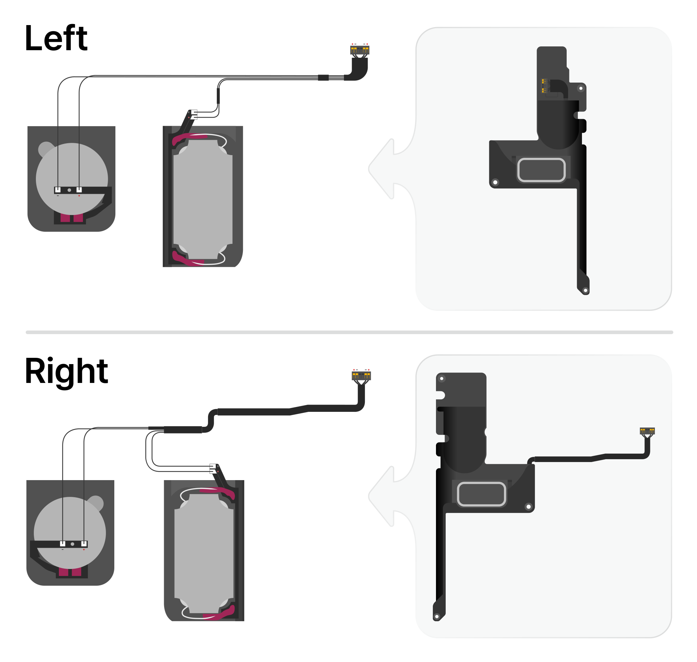
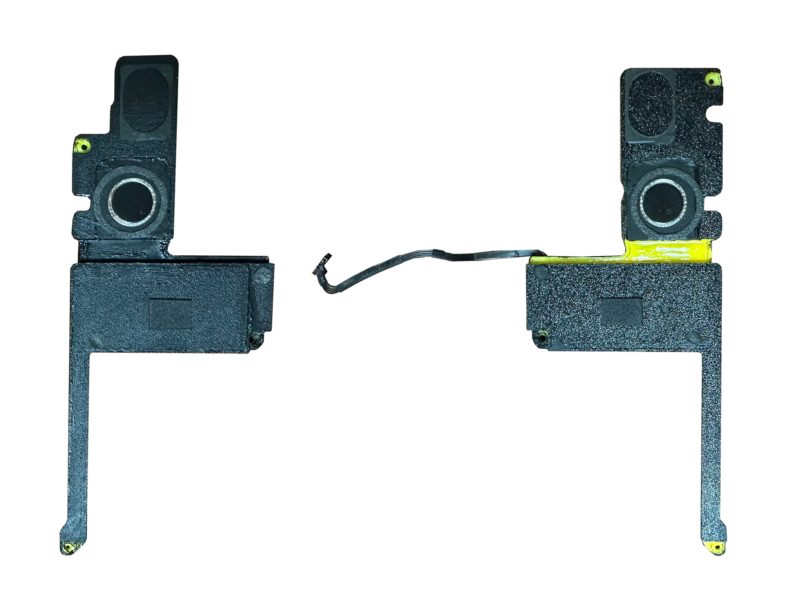
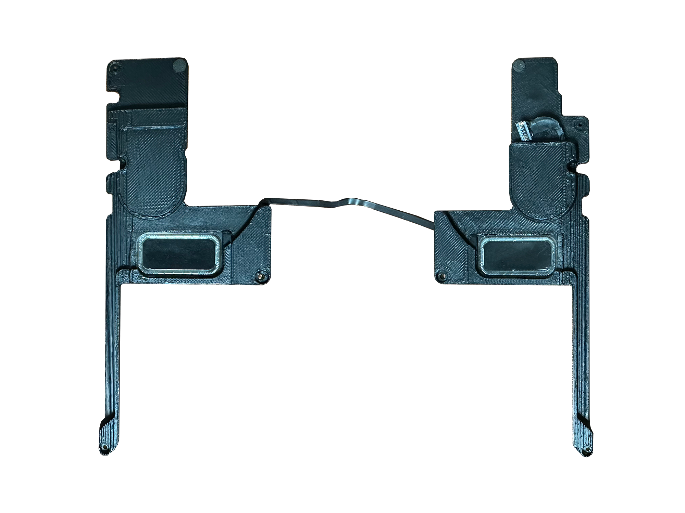

# MacBook Pro 15" (A1398, 2012–2015) Speaker Mod using A1707 Drivers

Custom speaker retrofit project replacing the fragile (easily torn) and tinny-sounding stock speakers of the **MacBook Pro 15" Retina (A1398, Mid 2012 – Mid 2015)** with high-fidelity units from the **MacBook Pro 15" Touch Bar (A1707, 2016–2017)** using custom 3D-printed enclosures and AppleALC audio patching.

> 🌐 **[한국어 설명서 (Korean Guide)](README_KR.md)**

---

## Frequency Response Comparison


> **Near-field measurement comparison (stock vs. modded, combined response):**
> Noticeable extension in low-frequency response, fuller and richer mids, and clearer highs without harshness.

---

## 🛠 Requirements & BOM

1. **Donor Speaker Drivers:**
   - 1 pair of Left & Right speaker modules from **MacBook Pro 15" Touch Bar (A1707, 2016–2017)**.
2. **Reused Parts from Stock A1398 Speakers:**
   - **Original A1398 speaker wiring & connector assembly** (salvaged directly from the old A1398 speakers — no separate AWG wires required!).
   - **Original vibration damper sponge stickers** from the old A1398 speaker enclosures.
3. **3D Printed Enclosures:**
   - Available in the [`Enclosure/`](Enclosure/) directory:
     - CAD Master Assembly: [`Enclosure.step`](Enclosure/Enclosure.step)
     - Left Parts: `L1.stl`, `L2.stl`, `L3.stl`, `L4.stl`
     - Right Parts: `R1.stl`, `R2.stl`, `R3.stl`, `R4.stl`
4. **Tools & Consumables:**
   - Soldering iron & solder
   - Precision cutters / hobby knife
   - UV resin and 2-part epoxy adhesive (essential for driver mounting and acoustic air-sealing)

---

## 🔨 Step-by-Step Hardware Guide

### Step 1: Disassemble A1707 Speakers & Desolder Tweeters

- ⚠️ **Caution:** Before separating the drivers, **desolder the tweeter flex cable joints first**. Forcibly prying the unit apart without desoldering will tear and ruin the delicate ribbon cable.

---

### Step 2: Trim the Driver Frame & Expose Copper Pads
| Cut Dimensions | Trimming & Scraping 1 | Trimming & Scraping 2 |
| :---: | :---: | :---: |
|  |  |  |
- Trim the plastic housing according to the dimensions shown in [cut size.png](<image/cut size.png>).
- Cut away the designated PCB section as shown in `3.png`, then carefully scrape away the top solder mask (black coating) to expose clean copper pads for wire soldering.

---

### Step 3: Enclosure Mounting & Acoustic Sealing
| Front | Rear |
| :---: | :---: |
|  |  |
- Mount the modified drivers into the 3D-printed enclosure parts using UV resin or epoxy.
- **Tip:** Extract the internal acoustic damping sponge from the original A1707 enclosure and insert it into the new 3D enclosure chamber.
- ⚠️ **Critical (Acoustic Seal):** Seal all wire pass-through holes and mating seams thoroughly with 2-part epoxy. Any air leak will significantly degrade bass response.

---

### Step 4: Wiring with Original A1398 Cable

- Salvage the original wiring harness and connector from the old A1398 speakers.
- Solder the wires to the woofer and tweeter pads following the pinout and polarity schematic in [make.png](image/make.png).

---

### Step 5: Final Assembly & Damper Transfer
| Front | Rear |
| :---: | :---: |
|  |  |
- Carefully peel the original sponge damper stickers off the stock A1398 speakers and reattach them onto the exact same locations on the 3D enclosures (prevents rattles and case interference).
- Install the completed assemblies into your A1398 chassis and plug in the connectors.

---

## 💻 Software Configuration (OCLP / OpenCore)

Because the A1707 uses a separate woofer and tweeter setup, custom routing and tuning are needed. A patched **AppleALC.kext** configured with **Cirrus Logic CS4208 Layout ID 128** is provided.

1. **Install `AppleALC.kext`**:
   - Copy the included [`AppleALC.kext`](AppleALC.kext) into your OpenCore EFI folder: `EFI/OC/Kexts/`.
2. **Update `config.plist`**:
   - Add the kext entry to `Kernel -> Add` in your `config.plist`:
   ```xml
   <dict>
       <key>Arch</key>
       <string>x86_64</string>
       <key>BundlePath</key>
       <string>AppleALC.kext</string>
       <key>Comment</key>
       <string>Audio Patch - CS4208 Layout 128</string>
       <key>Enabled</key>
       <true/>
       <key>ExecutablePath</key>
       <string>Contents/MacOS/AppleALC</string>
       <key>MaxKernel</key>
       <string></string>
       <key>MinKernel</key>
       <string></string>
       <key>PlistPath</key>
       <string>Contents/Info.plist</string>
   </dict>
   ```
   > **Note:** `AppleALC.kext` must be loaded **after** `Lilu.kext`.
3. **Boot Argument**:
   - Add `alcid=128` to `NVRAM -> Add -> 7C436110-AB2A-4BBB-A880-FE41995C9F82 -> boot-args`.

---

## ⚠️ Disclaimer
- This modification involves precision cutting, PCB scraping, soldering, and complete laptop disassembly.
- Proceed at your own risk. The author is not responsible for any damage caused to your hardware.

---

## 📄 License
This project is licensed under the [MIT License](LICENSE).
