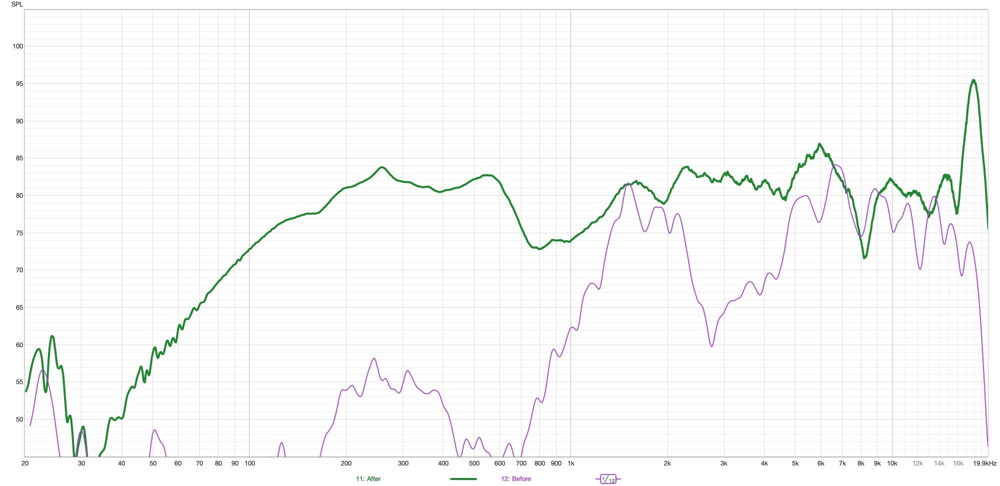
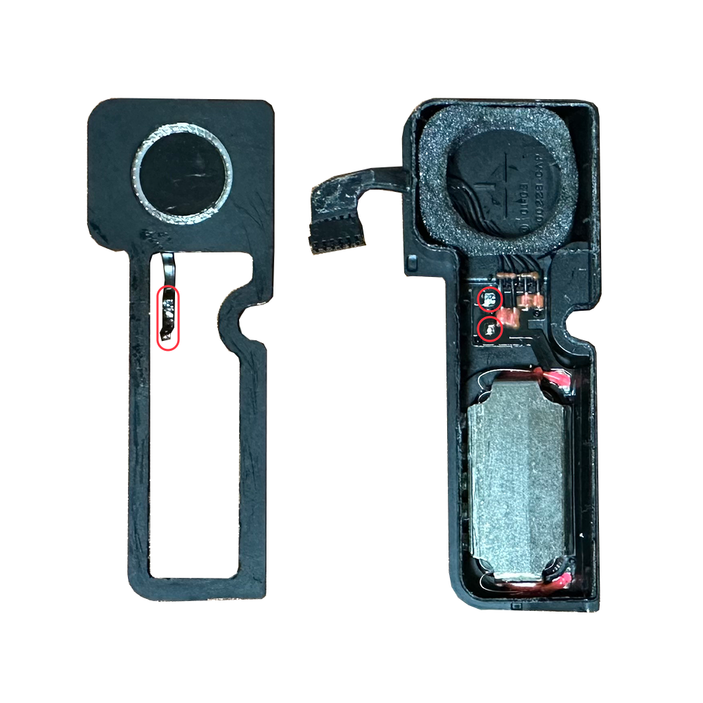
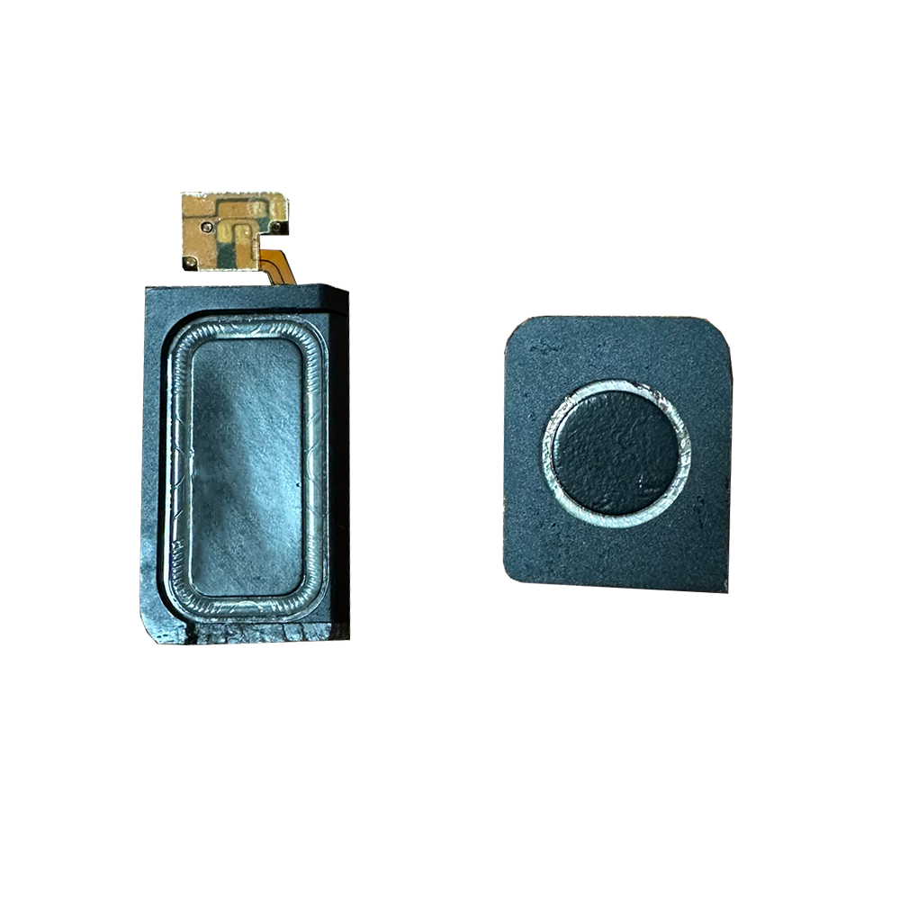
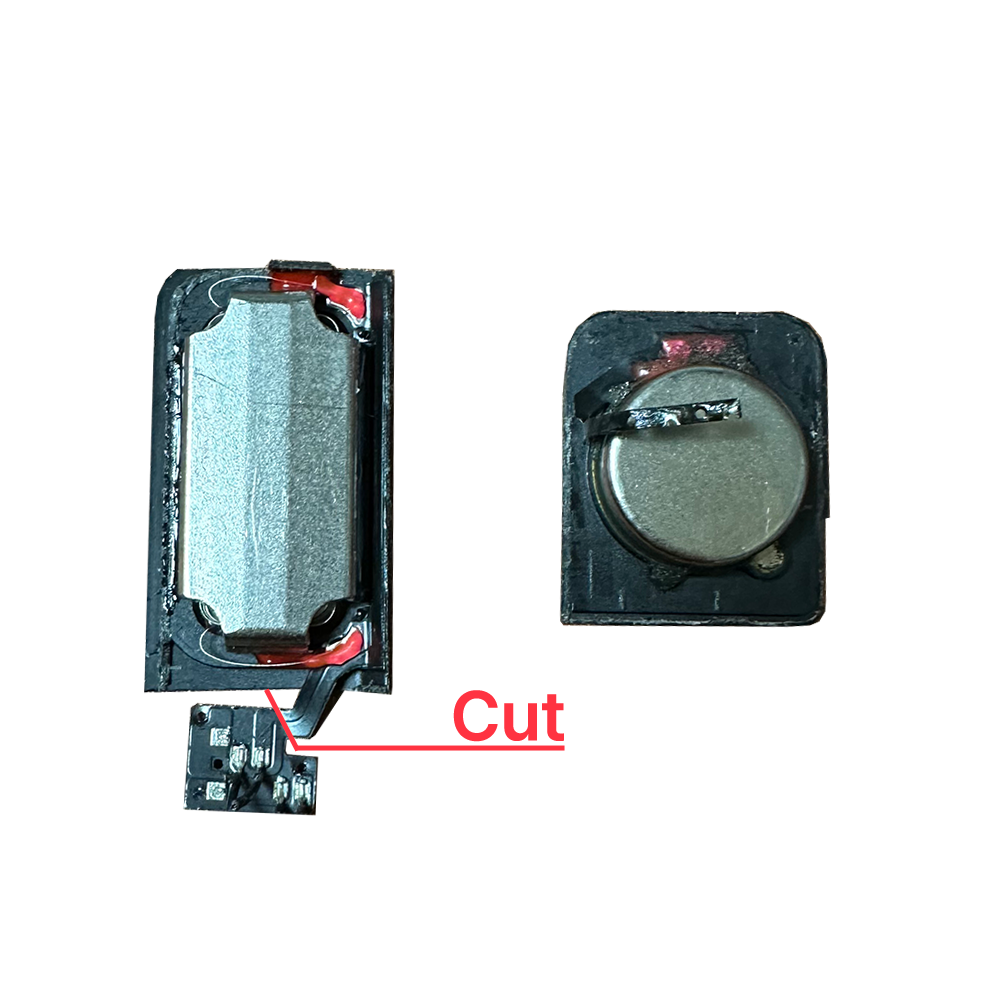
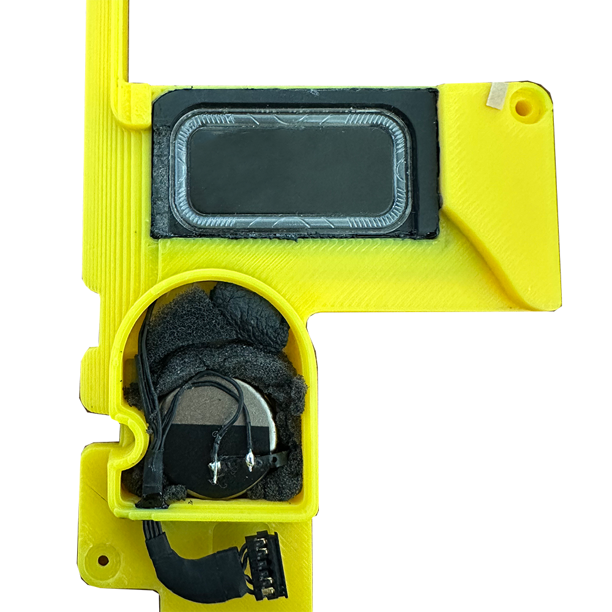
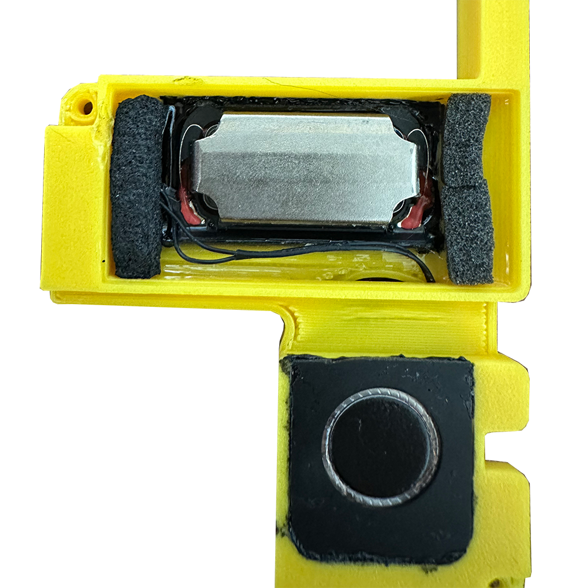
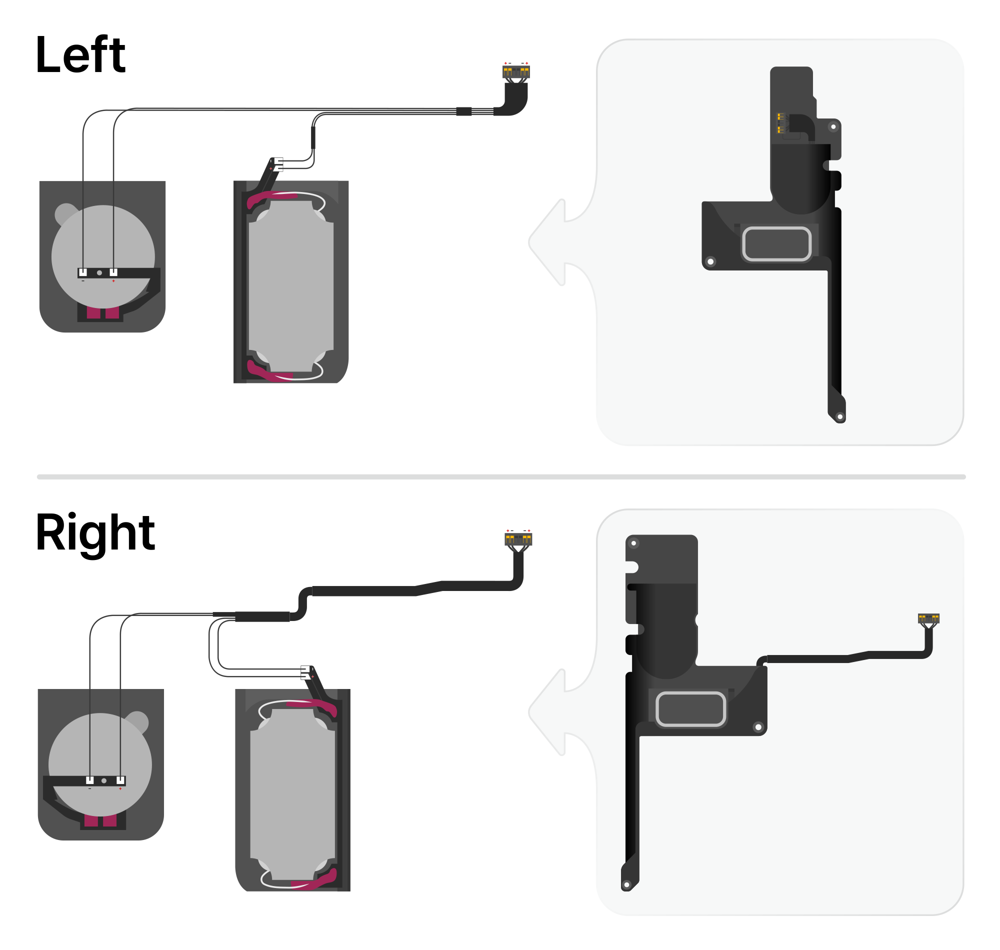
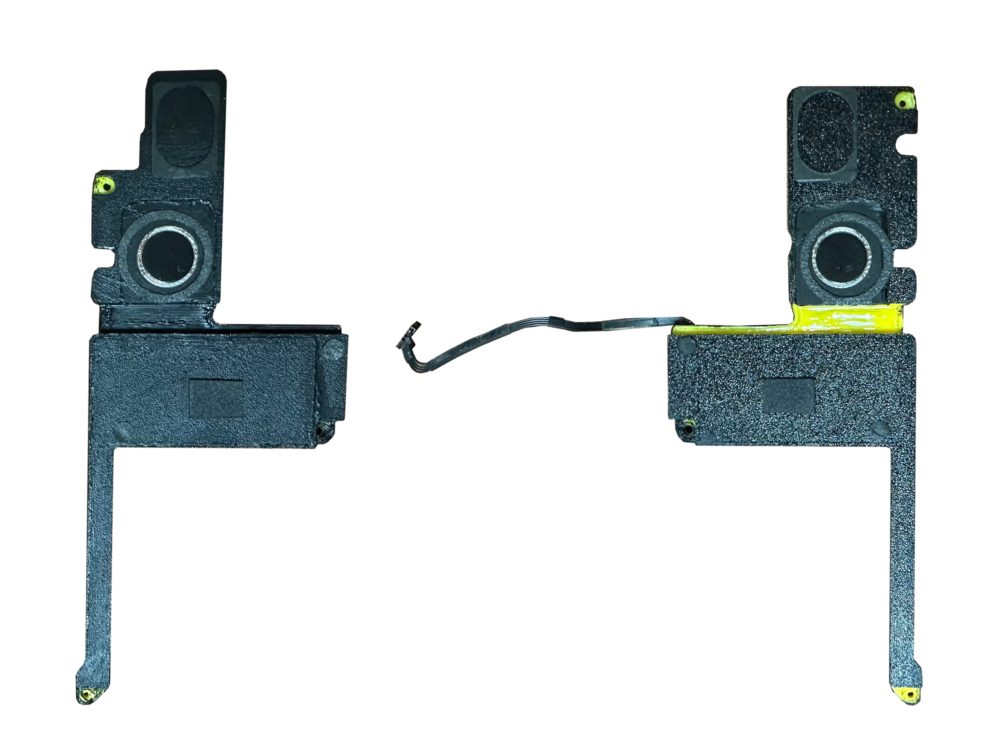
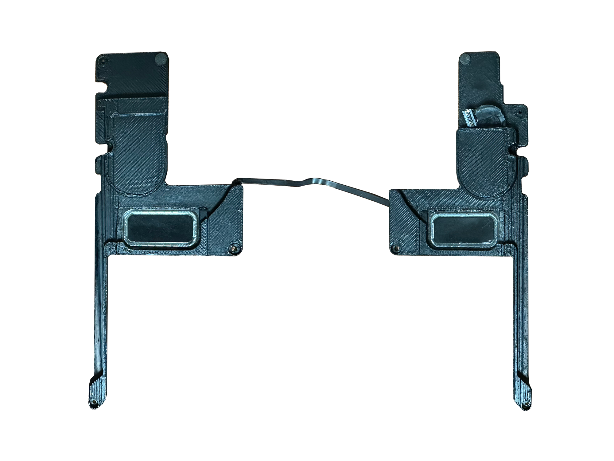

# MacBook Pro 15" (A1398) A1707 스피커 이식 튜닝 프로젝트

쉽게 찢어지는등 내구성이 좋지않고, 깡통소리가 나서 음질도 좋지 않은 **맥북 프로 레티나 15인치(A1398, 2012~2015)**의 순정 스피커를, **맥북 프로 15인치 터치바(A1707, 2016~2017)**의 스피커 유닛으로 교체하는 하드웨어 및 소프트웨어 튜닝 프로젝트입니다.

> 🌐 **[English Guide](README.md)**

---

## 📌 지원 기종 및 호환성 안내 (Compatibility)

| 기종 구분 | 모델 식별자 (Model ID) | 코덱 칩셋 | 네이티브 Layout | 하드웨어 장착 | KEXT 지원 여부 |
| :--- | :--- | :--- | :---: | :---: | :---: |
| **Late 2013 ~ Mid 2014** (Haswell) | `MacBookPro11,2`, `11,3` | Cirrus Logic CS4208 | Layout 128 | 호환 가능 ✅ | **기본 제공 Kext 바로 사용 가능 ✅** |
| **Mid 2015** (Haswell Refresh / Broadwell) | `MacBookPro11,4`, `11,5` | Cirrus Logic CS4208 | Layout 128 | 호환 가능 ✅ | **기본 제공 Kext 바로 사용 가능 ✅ (실측 기준)** |
| **Mid 2012 ~ Early 2013** (Ivy Bridge) | `MacBookPro10,1` | Cirrus Logic CS4206 | Layout 90 / 92 | 호환 가능 ✅ | **직접 이식 및 빌드 필요 🛠️ ([가이드](AppleALC-A1398-Tuned/))** |

> 💡 **2012 ~ Early 2013 (MacBookPro10,1) 기종 안내:**
> A1398 전 연식은 내부 스피커 인클로저 규격(APN: 923-0660)이 동일하므로 3D 인클로저 및 유닛 개조 작업은 100% 동일하게 장착 가능합니다.  
> 단, 오디오 코덱이 CS4206(Layout 90/92)으로 다르므로, 본 저장소의 [`AppleALC-A1398-Tuned`](AppleALC-A1398-Tuned/) 폴더에 제공되는 순정 XML(`layout90`, `layout92`)과 설명서를 참고하여 DSP 설정을 직접 이식/빌드하여 사용하시기 바랍니다.

---

## 📊 주파수 응답 측정치 비교 (Frequency Response)


> **순정 A1398 스피커 vs A1707 개조 스피커 측정치 비교 (유닛 근접 측정 후 합성):**
> 저음 대역 확장 및 주파수 응답 변화를 확인할 수 있습니다.

---

## 🛠 준비물

1. **기증 스피커 드라이버:**
   - **MacBook Pro 15" 터치바 (A1707, 2016–2017)** 스피커 좌/우 1쌍
2. **기존 A1398 순정 스피커에서 재활용하는 부품:**
   - **순정 배선 및 메인보드 커넥터 어셈블리** (별도 전선을 따로 살 필요 없이 기존 A1398 스피커의 배선을 뜯어서 그대로 사용합니다.)
   - **진동 방지 스펀지 스티커**
3. **3D 프린팅 인클로저 부품:**
   - [`Enclosure/`](Enclosure/) 폴더 참조:
     - CAD 원본 어셈블리: [`Enclosure.step`](Enclosure/Enclosure.step)
     - 좌측 파트: `L1.stl`, `L2.stl`, `L3.stl`, `L4.stl`
     - 우측 파트: `R1.stl`, `R2.stl`, `R3.stl`, `R4.stl`
4. **도구 및 부자재:**
   - 납땜 도구 (인두기, 실납)
   - 정밀 니퍼, 아트나이프 (보드 및 하우징 가공용)
   - UV 레진 및 2액형 에폭시 접착제 (유닛 접착 및 음압 밀폐용)

---

## 🔨 단계별 하드웨어 제작 가이드

### 1단계: A1707 스피커 분해 및 트위터 케이블 분리

- ⚠️ **주의:** A1707 스피커를 분리할 때 **트위터 케이블이 납땜된 부위를 먼저 인두기로 분리(디솔더링)**해야 합니다. 납땜을 떼지 않고 힘으로 분리하면 얇은 필름 케이블이 찢어져 유닛을 못 쓰게 될 수 있습니다.

---

### 2단계: 드라이버 프레임 절단 가공 및 동박면 노출
| 절단 가공 규격 | 가공 및 긁어내기 1 | 가공 및 긁어내기 2 |
| :---: | :---: | :---: |
|  |  |  |
- [cut size.png](<image/cut size.png>)의 상세 가공 규격을 참고하여 플라스틱 하우징을 정밀하게 잘라냅니다.
- `3.png` 사진에서 보이는 것처럼 보드부분을 잘라내고, 절단면 윗부분의 솔더레지스트(블랙 코팅)를 조심스럽게 긁어내어 깨끗한 **동박면**을 만듭니다.

---

### 3단계: 3D 인클로저 이식 및 에폭시 음압 밀폐
| 앞면 | 뒷면 |
| :---: | :---: |
|  |  |
- 3D 출력한 인클로저 부품에 가공한 드라이버 유닛을 결합하고 레진이나 에폭시로 단단히 접착합니다.
- **추천:** 기존 A1707 스피커 인클로저 내부에 있던 흡음용 스펀지도 뜯어서 새 3D 인클로저 챔버 안에 함께 넣어주는 것이 좋습니다.
- ⚠️ **음압 밀폐:** 배선이 통과하는 구멍이나 부품 결합 틈새는 2액형 에폭시로 밀폐해야 합니다. 공기가 새어나가면 저음이 약해집니다.

---

### 4단계: 기존 A1398 배선 재활용 결선

- 기존 A1398 스피커에서 분리해 둔 순정 케이블과 커넥터를 준비합니다.
- [make.png](image/make.png)의 회로 및 극성 배치도에 맞춰 트위터와 우퍼 접점에 납땜합니다.

---

### 5단계: 최종 조립 및 스펀지 스티커 부착
| 앞면 | 뒷면 |
| :---: | :---: |
|  |  |
- 기존 A1398 스피커에 붙어 있던 진동 방지 스펀지 스티커를 떼어내어 새 인클로저의 동일한 위치에 붙입니다. (노트북 하판과의 간섭 및 공진/잡소리 방지)
- 완성된 모듈을 A1398 노트북 본체에 장착하고 나사로 고정한 뒤 메인보드에 커넥터를 연결합니다.

---

## 💻 소프트웨어 설정 (OCLP / OpenCore)

1. **`AppleALC.kext` 복사**:
   - 저장소의 [`AppleALC.kext`](AppleALC.kext)를 OpenCore EFI 파티션의 `EFI/OC/Kexts/` 폴더에 복사합니다.
2. **`config.plist` 등록**:
   - OpenCore `config.plist`의 `Kernel -> Add`에 `AppleALC.kext` 항목을 등록합니다:
   ```xml
   <dict>
       <key>Arch</key>
       <string>x86_64</string>
       <key>BundlePath</key>
       <string>AppleALC.kext</string>
       <key>Comment</key>
       <string>Audio Patch - CS4208 Layout 128</string>
       <key>Enabled</key>
       <true/>
       <key>ExecutablePath</key>
       <string>Contents/MacOS/AppleALC</string>
       <key>MaxKernel</key>
       <string></string>
       <key>MinKernel</key>
       <string></string>
       <key>PlistPath</key>
       <string>Contents/Info.plist</string>
   </dict>
   ```
   > **참고:** `AppleALC.kext`는 반드시 `Lilu.kext`보다 뒤쪽(아래)에 위치해야 합니다.
3. **부트 인자 (Boot-args) 설정**:
   - `NVRAM -> Add -> 7C436110-AB2A-4BBB-A880-FE41995C9F82 -> boot-args`에 반드시 `alcid=128`을 추가합니다.

---

## 🔬 AppleALC 및 layout128.xml 패치 내용

본 저장소의 [`AppleALC.kext`](AppleALC.kext)는 **A1398의 하드웨어 설정에 A1707 (Layout 57)의 DSP 설정을 적용**하여 제작되었습니다.

1. **A1398 순정 하드웨어 통신 유지**: 코덱 식별자, 이어폰 잭 감지, 마이크, 광출력(SPDIF) 등 스피커 외 모든 기능은 A1398 순정 설정을 유지합니다.
2. **A1707 DSP 적용**: A1707(`layout57.xml`)의 스피커 DSP(EQ, 컴프레서, 딜레이, 진동 억제, 리미터 등) 설정을 적용했습니다.
3. **A1398 앰프 출력 조정**:
   - 4채널 앰프 출력단(`Dsp4ChOutput`) 게인을 A1398 아날로그 앰프 규격(`Param 4/5 = 0.051`)으로 유지했습니다.
   - 유닛 감지 ID(`SignalProcessingIDs`)를 0번으로 통일하여 항상 해당 DSP 프로필이 동작하도록 설정했습니다.
4. **A1398 CS4208 전용 빌드**: 타 기종 코덱 및 핀 설정을 제외하고 A1398(CS4208)용 설정만 포함하여 빌드했습니다.

---

## ⚠️ 면책 조항 (Disclaimer)
- 본 개조 작업은 부품 절단 가공, 동박면 긁어내기, 납땜, 맥북 본체 분해가 필요합니다.
- 작업 중 발생할 수 있는 하드웨어 손상 및 고장에 대한 책임은 작업자 본인에게 있습니다.

---

## 📄 라이선스 및 크레딧 (License & Credits)
- 본 저장소의 하드웨어 개조 가이드 및 3D 모델 파일은 [MIT License](LICENSE)에 따라 자유롭게 사용, 수정 및 배포할 수 있습니다.
- `AppleALC.kext` 및 관련 소스코드는 [Acidanthera 팀의 AppleALC](https://github.com/acidanthera/AppleALC) 오픈소스 프로젝트(BSD 3-Clause License)를 기반으로 하여 A1398용 커스텀 DSP 및 핀맵 설정을 적용해 빌드되었습니다.
- Lilu by vit9696.
